

# Ghost FTP

> **Ghost FTP 0.99.43 Preview development. Previous verified public release: v0.99.42. This cycle hardens OAuth credential redaction; Windows/Linux must remain splash-free.**

### More Than Transfer. Total Control.

**Your files. Your servers. One beautifully focused workspace.**

Move files, manage connections and keep important server work organized with an elegant, privacy-conscious file-transfer client.

**Windows** · **Linux** · **macOS Preview**

Ghost FTP 0.99.42 (development Preview) · Previously published: v0.99.41. Every successfully verified new edition is automatically published on <a href="https://github.com/bren-wp/Ghost-FTP/releases">GitHub Releases</a> with versioned installers, source archives and SHA-256 checksums. Only signed/certified editions may be labeled stable.

[**Releases**](https://github.com/bren-wp/Ghost-FTP/releases) · [Windows/Linux transfer security audit](docs/audits/WIN_LINUX_TRANSFER_RESUME_2026_11_07.md) · [Windows/Linux unsigned installation](docs/guides/INSTALLATION.md#unsigned-windowslinux-installation-and-manual-upgrade) · [Explore screenshots](#see-ghost-ftp-in-action) · [Help & documentation](https://ghostftp.com/hr/support) · [Release notes](CHANGELOG.md)

---

## Release integrity

The 0.99.42 Preview development cycle preserves the splash-free Windows/Linux UI and corrects a verified historical release metadata incident without replacing archived binaries. Production signing and pixel-by-pixel visual acceptance remain separate.

## Made for Windows & Linux

**Dependable transfers. A focused workspace.** Ghost FTP 0.99.42 opens directly into the Files workspace on Windows and Linux, without an unnecessary startup splash. The saved transfer scheduler also promptly re-checks due work after a suspended window or network reconnect. Windows and Linux share native Rust/Tauri transfer handling, FTP/FTPS/SFTP security checks and responsive file-management tools. Native integration, cloud-provider and pixel-perfect acceptance remain independently verifiable requirements—not assumed guarantees.

## See Ghost FTP in action

<a href="docs/assets/screenshots/ghostftp-native-files.png">
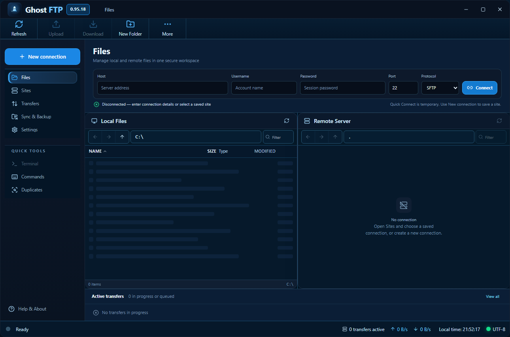
</a>

Seven authentic Ghost FTP Windows <strong>0.95.53</strong> WebView2 screenshots (1290×852), recorded in <a href="https://github.com/bren-wp/Ghost-FTP/actions/runs/39506868388">successful native CI run 39506868388</a> from source SHA <code>27a3f8413f168e4cb8cc31cf6d7b7c85c353f5af</code>. Original SHA-256 hashes and provenance appear in <a href="docs/assets/screenshots/README-NATIVE-CAPTURE.json">the capture manifest</a>. Actual running-application screenshots, not mockups.

<table>
<tr>
<td width="50%" align="center"><a href="docs/assets/screenshots/ghostftp-native-new-connection.png">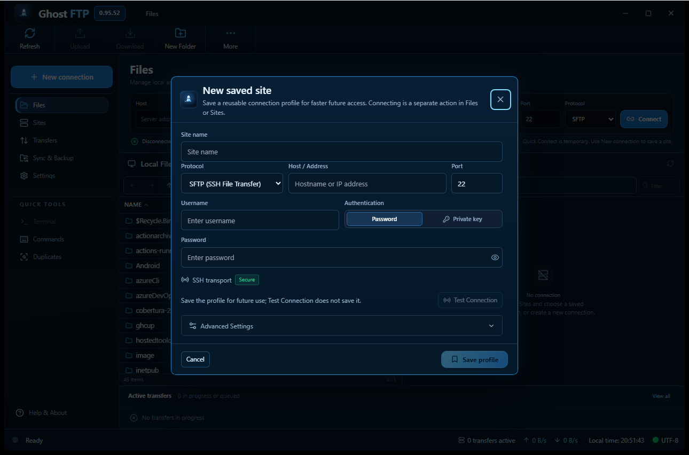</a> <strong>New Connection</strong> Your connection, your settings.</td>
<td width="50%" align="center"><a href="docs/assets/screenshots/ghostftp-native-sites.png">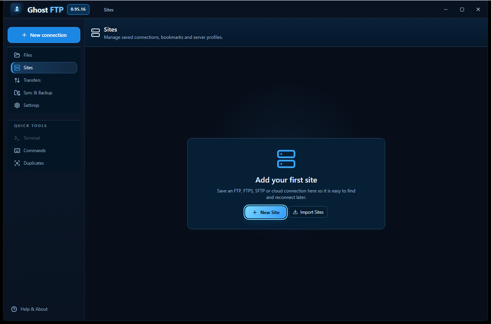</a> <strong>Saved Sites</strong> Everything organized in one place.</td>
</tr>
<tr>
<td align="center"><a href="docs/assets/screenshots/ghostftp-native-transfers.png">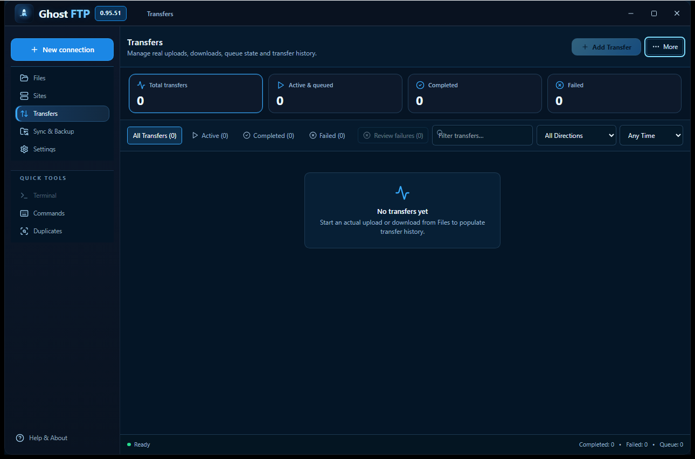</a> <strong>Transfer Center</strong> Stay in control of every transfer.</td>
<td align="center"><a href="docs/assets/screenshots/ghostftp-native-settings.png">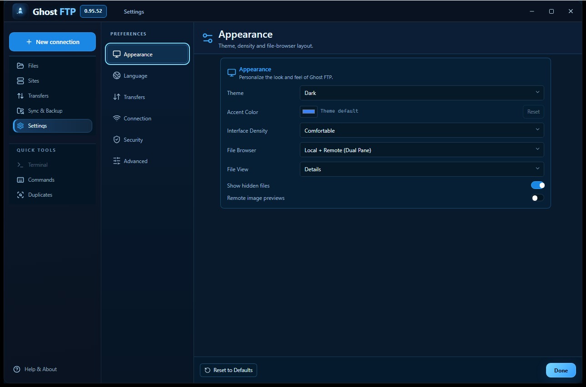</a> <strong>Settings</strong> Make the workspace yours.</td>
</tr>
<tr>
<td align="center"><a href="docs/assets/screenshots/ghostftp-native-file-properties.png">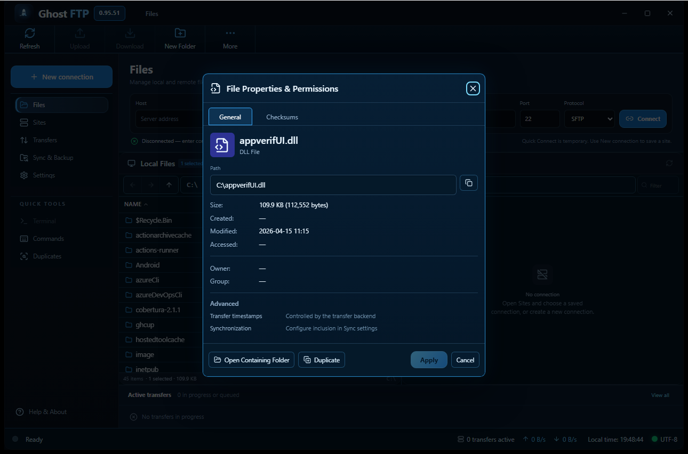</a> <strong>File Properties</strong> Know exactly what you manage.</td>
<td align="center"><a href="docs/assets/screenshots/ghostftp-native-about.png">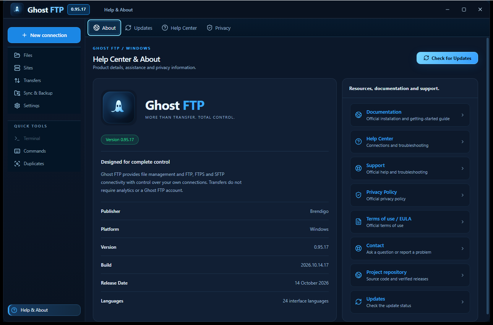</a> <strong>Help & About</strong> Everything you need, close at hand.</td>
</tr>
</table>

**The gallery contains real Windows application captures, not generated marketing mockups.** The 1290×852 screenshot geometry is a design acceptance reference; newer desktop builds need their own native visual comparison and manual QA before 1:1 fidelity can be confirmed.

### Linux — real Tauri/WebKit captures

Linux visuals are captured from the **actual running Ghost FTP executable**, not the supplied designs. The [native Linux QA artifact (v0.99.19)](https://github.com/bren-wp/Ghost-FTP/actions/runs/40793685872/artifacts/12862768368) contains the original **1290×852 Files and Sync screenshots**, including SHA-256 checksums and launch logs. See the [evidence and measured differences](docs/qa/PHASE3_REAL_WINDOWS_LINUX_SYNC_V0_99_19_2026_10_29.md). Historical artifact availability is subject to GitHub Actions retention.

The historical Preview gallery includes **seven genuine Linux workspaces**: Files, Sites, New Connection, Transfers, Settings, Sync and About. The former splash image is archived as an earlier QA capture, but the desktop app now launches directly into Files. These are byte-verified native QA captures from GitHub Actions run 41524829466 at source SHA 01d816df5bdd3c76a8fa9c062371777cd345aa28, **not screenshots from the published v0.99.29 release**. They are evidence for comparison, not proof of pixel-perfect 1:1 design acceptance. Reference mockups are **never** repurposed as product screenshots.

## Install Ghost FTP on macOS without paid Apple signing

Ghost FTP Desktop is available as a separate **Apple Silicon ARM64** or **Intel x86_64** installable DMG Preview, as well as ZIP. No Apple Developer account or Developer ID signing certificate is required. Download the matching package from [GitHub Releases](https://github.com/bren-wp/Ghost-FTP/releases), open its DMG in Finder, drag **Ghost FTP Desktop.app** to **Applications**, then open the installed app. Because this development Preview is not notarized, you may need **System Settings → Privacy & Security → Open Anyway** after the first launch attempt. Do not disable Gatekeeper. The embedded code uses only free ad-hoc signing for Apple Silicon integrity. Full [Croatian/English installation instructions](docs/guides/MACOS_INSTALLATION.md).

## Client-only distribution (0.99.30 development Preview)

Only the **Ghost FTP graphical client** is distributed for Windows, Linux and macOS. Installers, binaries and source packages for the previously separate Server, Demo and CLI have been removed from this source train. FTP, FTPS, SFTP and the existing client-side transfer engines are retained where supported by each platform.

Published v0.99.29 and earlier releases remain immutable. See [platform packages](docs/distribution/PLATFORM_PACKAGES.md), [published v0.99.27 release notes](docs/releases/0.99.27.md), and [0.99.28 Windows/Linux reliability changes](docs/releases/0.99.28.md).

## Designed for your workflow

### 🔐 Connections you can trust

Connect to servers with **FTP, explicit FTPS or SFTP** on Windows and Linux. See connection status clearly, manage reusable Sites and use temporary connections without saving credentials. Encrypted protocols validate the server's identity; ordinary FTP remains unencrypted.

### 📁 A better place for files

Navigate local and remote directories, upload and download, create folders, rename, inspect properties and manage files from a focused workspace. Destructive operations use explicit safeguards so important changes are intentional.

### ⚡ Transfers with more control

Follow transfer progress and manage queues, retries, conflicts and interruptions on the Windows/Linux desktop. Sync, backup and productivity tools help keep routine server tasks organized.

### 🛡️ Privacy is part of the design

**No Ghost FTP account required. No mandatory analytics or telemetry.** Passwords and sensitive keys use protected storage where supported, and connection metadata is handled with privacy in mind. Ghost FTP does not use a relay server for ordinary file transfers.

### 🎨 A polished, consistent experience

Dark premium styling, clear navigation, accessible controls and responsive layouts help you focus on the files—not the interface. Each platform uses its own controls and capabilities rather than pretending unsupported functions exist.

## Safer file operations on Windows and Linux

The current source hardens FTP/FTPS and SFTP directory inventories against oversized, malformed or ambiguous server listings. On Windows and Linux, staged downloads preserve existing backups and refuse symlink/special-node replacements; folder uploads fail closed on unsafe entries, and drag/drop rejects stale server sessions. SSH host-key changes require explicit verification, same-batch name collisions are guarded, and sensitive errors are redacted in file and transfer views. Ghost FTP does not claim atomic remote multi-file operations or blanket feature superiority without independently verified tests.

For the current Windows/Linux audit scope, coverage and outstanding gaps, see [Windows & Linux audit v0.95.35](docs/audits/WINDOWS_LINUX_0.95.35.md). The source and CI checks cannot alone prove all 75 reference screens match pixel-for-pixel or that Ghost FTP exceeds FileZilla in every feature.

Current source includes native OS-keyring credential protection (Windows native credential storage and Linux Secret Service), safety-checked continuous folder synchronization, editor upload retry protection, and safe PowerShell/CMD/.NET watcher script generation from additive sync pairs. [Security & sync audit](docs/audits/KEYCHAIN_LIVE_SYNC_0.95.36.md) records exact behavior and remaining work. Advanced built-in syntax highlighting and vendor-authenticated cloud E2E are not yet release-verified.

Ghost FTP v0.95.37 adds a **built-in code editor** (PHP/JS/HTML/CSS highlighting, search, bracket completion and indentation) for small remote UTF-8 text files, plus SQLite-backed, transaction-safe continuous folder-sync configuration. Existing OS-protected secret storage remains separate from the SQLite database. [Migration and editor audit](docs/audits/SQLITE_EDITOR_0.95.37.md).

The v0.95.38 development cycle hardens [SQLite-backed watched sync](docs/audits/SQLITE_SYNC_INTEGRITY_0.95.38.md) with atomic state commits and refuses partial directory scans before any Mirror deletion. SQLite is a **local transactional database, not encryption**; connection passwords stay in the native OS credential service. The project does not require a proprietary hosted backend for local profile and sync storage.

## Choose your platform

| Platform | Package options | Supported connections |
| --- | --- | --- |
| **🪟 Windows x64** | Portable EXE, Setup EXE, MSI | FTP, explicit FTPS, SFTP |
| **🐧 Linux x86-64** | AppImage, DEB (Debian/Ubuntu family), RPM (Fedora/openSUSE/RHEL family), standalone ELF; [distro/package matrix](docs/distribution/LINUX_PACKAGE_MATRIX.md) | FTP, explicit FTPS, SFTP |
| **🍎 macOS — Shared Desktop candidate (0.99.4)** | Separate Preview ZIP after exact-source CI passes | Shared Rust FTP, explicit FTPS and SFTP; real-machine acceptance pending |
| **🍎 macOS — legacy SwiftUI** | Existing Preview ZIP | FTP only; FTPS/SFTP intentionally unavailable |

**[View all Ghost FTP releases, including the latest Preview →](https://github.com/bren-wp/Ghost-FTP/releases)**

The macOS Preview is not a Developer ID-signed, notarized App Store distribution. Availability through Apple's distribution channels requires platform-specific signing, testing and review.

## Cloud storage, without confusion

Windows and Linux offer cloud and remote-storage integrations, including S3-compatible and WebDAV services and supported account-based connectors. The new shared macOS desktop candidate reuses these integrations; the legacy SwiftUI macOS app also supports direct object transfers via short-lived provider-signed HTTPS links. **A signed object link is not an account-browser login** to Google Drive, OneDrive, Dropbox or Box on those platforms.

[Cloud storage information](docs/product/CLOUD_STORAGE.md) · [Privacy policy](https://ghostftp.com/hr/privacy)

## Privacy that stays in your hands

## Questions? We're here to help.

For instructions, troubleshooting, updates and product information, use these official resources:

[Documentation](https://ghostftp.com/hr/how-to-download) · [Release downloads](https://github.com/bren-wp/Ghost-FTP/releases) · [Report an issue](https://ghostftp.com/hr/contact) · [Support](https://ghostftp.com/hr/support) · [Security](https://ghostftp.com/hr/security) · [Privacy](https://ghostftp.com/hr/privacy) · [License](LICENSE.txt) · [Terms](https://ghostftp.com/hr/terms)

---

**Ghost FTP — More Than Transfer. Total Control.**

Made by **Brendigo**.

<!-- BEGIN:real-linux-native-captures -->

### Linux — seven real native Ghost FTP workspaces

<table>
<tr>
<td align="center"><a href="docs/assets/screenshots/native-linux/ghostftp-linux-files.png">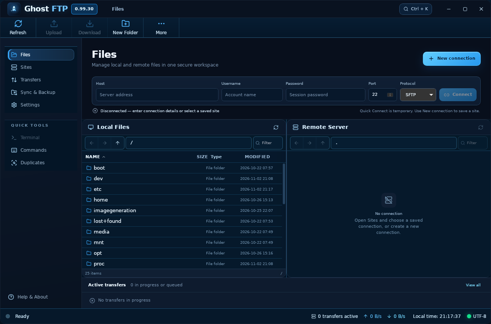</a><strong>Files</strong></td>
<td align="center"><a href="docs/assets/screenshots/native-linux/ghostftp-linux-sites.png">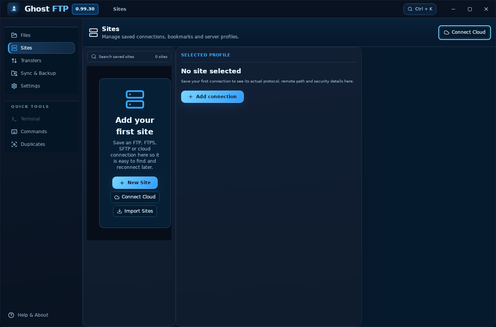</a><strong>Sites</strong></td>
</tr>
<tr>
<td align="center"><a href="docs/assets/screenshots/native-linux/ghostftp-linux-new-connection.png">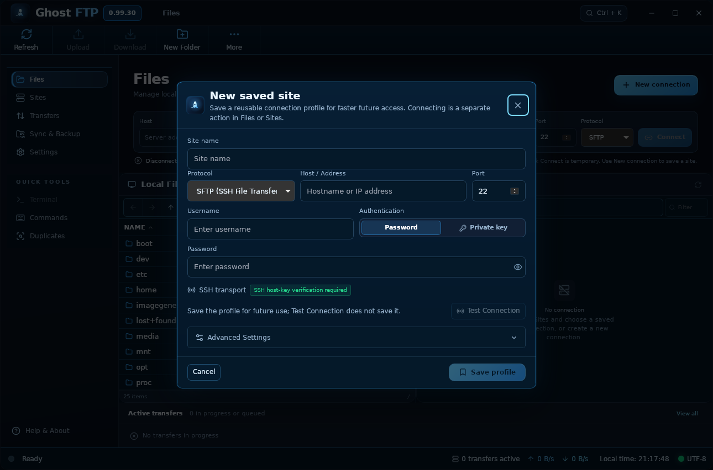</a><strong>New Connection</strong></td>
<td align="center"><a href="docs/assets/screenshots/native-linux/ghostftp-linux-transfers.png">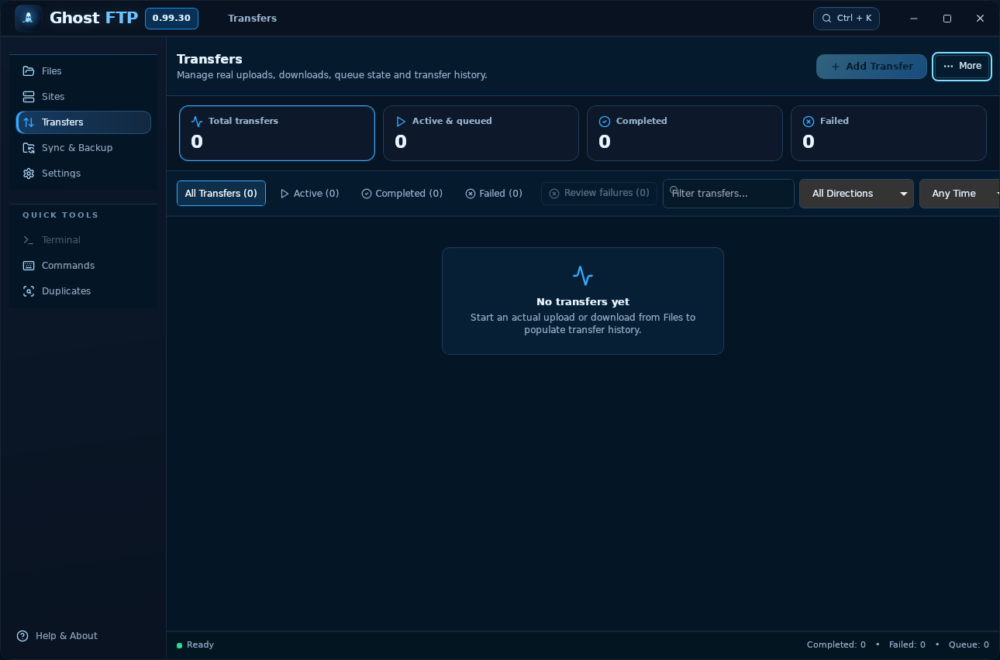</a><strong>Transfers</strong></td>
</tr>
<tr>
<td align="center"><a href="docs/assets/screenshots/native-linux/ghostftp-linux-settings.png">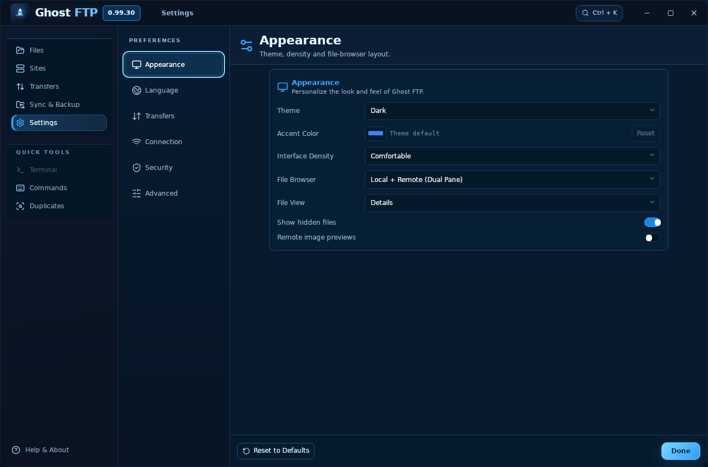</a><strong>Settings</strong></td>
<td align="center"><a href="docs/assets/screenshots/native-linux/ghostftp-linux-sync.png">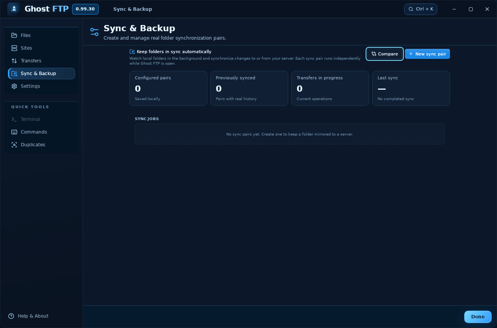</a><strong>Sync</strong></td>
</tr>
<tr>
<td align="center"><a href="docs/assets/screenshots/native-linux/ghostftp-linux-about.png">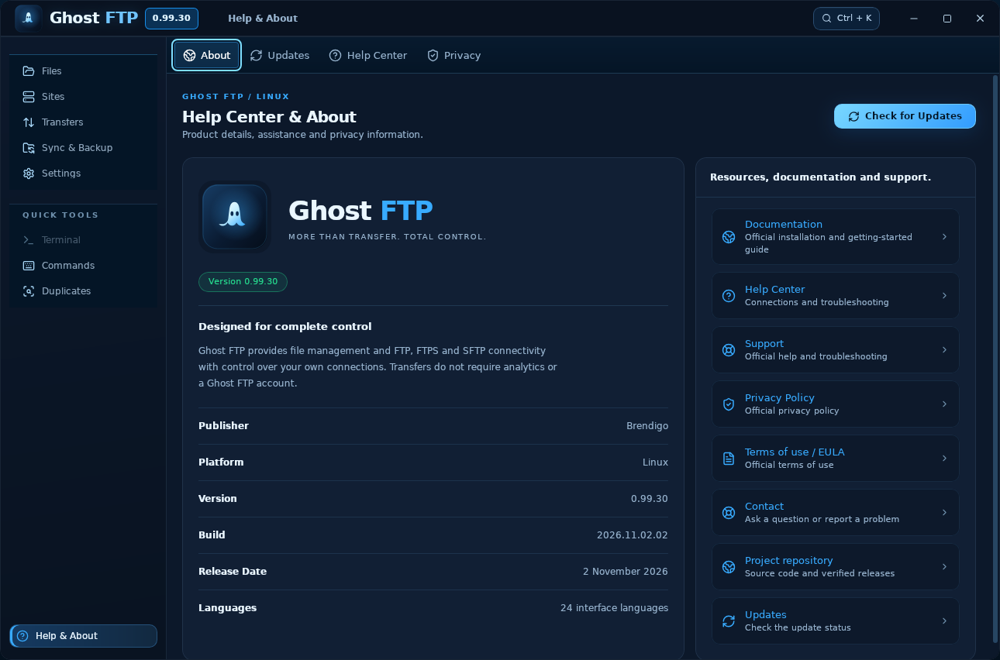</a><strong>About</strong></td>
</tr>
</table>

Verified <strong>real Linux Tauri/WebKit UI</strong> from <a href="https://github.com/bren-wp/Ghost-FTP/actions/runs/41524829466">GitHub Actions native build 41524829466</a>; source SHA <code>01d816df5bdd3c76a8fa9c062371777cd345aa28</code>. Captured at 1290×852 in Xvfb, no fabricated FTP connections, no design mockups. These seven screenshots predate the no-splash update; they remain historical evidence, not screenshots of the new build or pixel-perfect acceptance. The old splash PNG is retained only in historical QA data, not in the active gallery.

<!-- END:real-linux-native-captures -->
