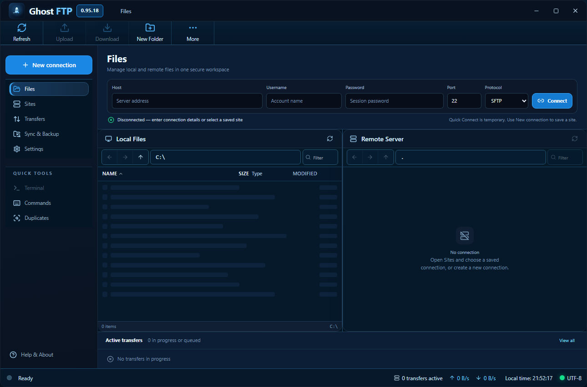
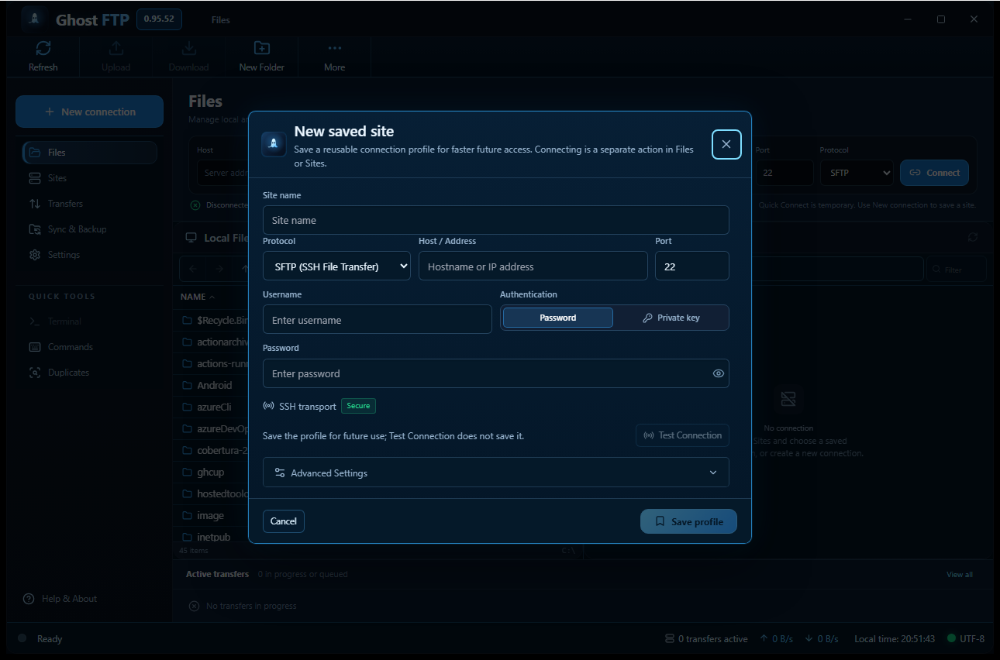
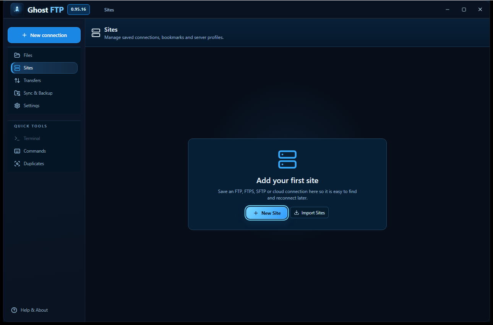
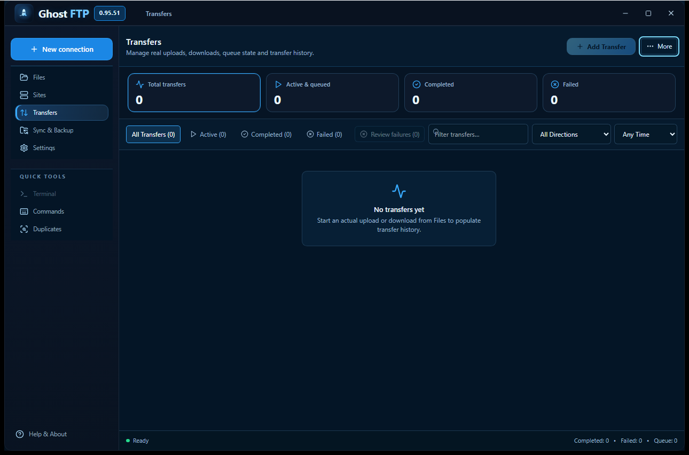
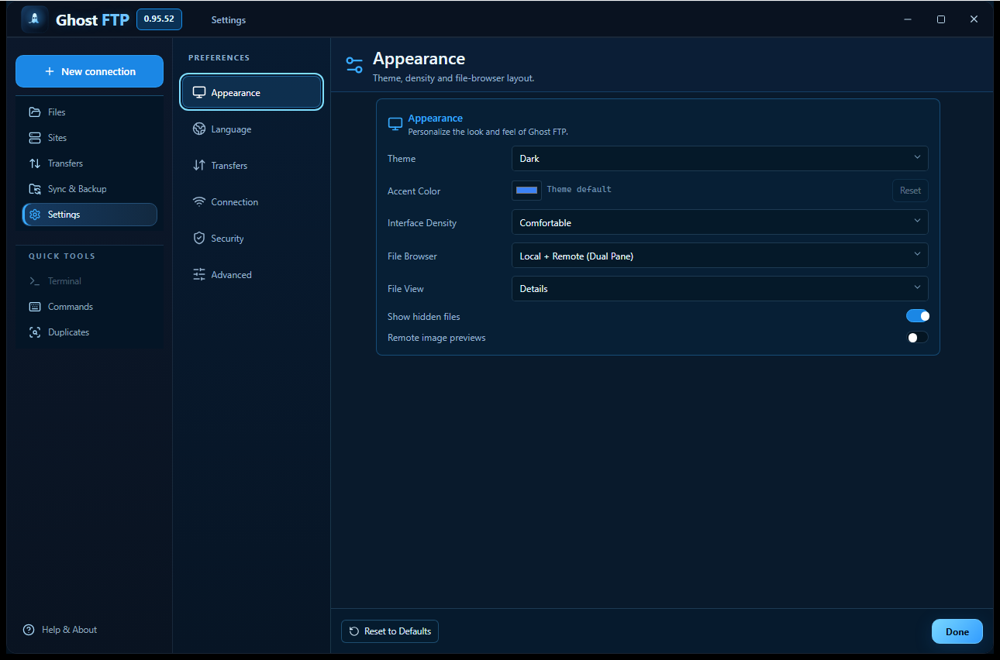
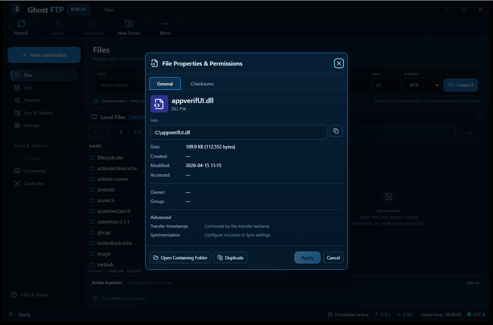
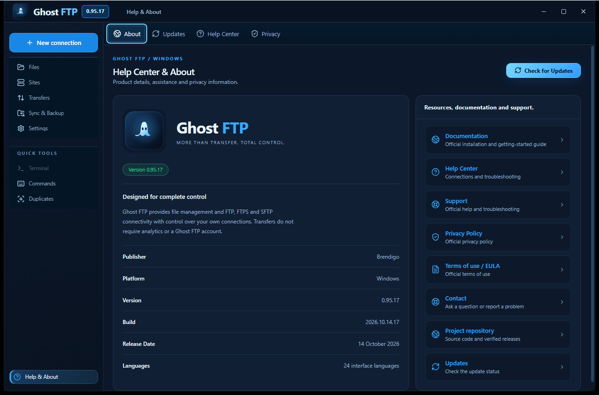

# Ghost FTP

### More Than Transfer. Total Control.

**Your files. Your servers. One beautifully focused workspace.**

Move files, manage connections and keep important server work organized with an elegant, privacy-conscious file-transfer client.

**Windows** · **Linux** · **Android** · **macOS Preview**

Ghost FTP 0.95.38 (development preview) · Latest published release: [v0.95.37](https://github.com/bren-wp/Ghost-FTP/releases/tag/v0.95.37)

[**Download Ghost FTP**](https://github.com/bren-wp/Ghost-FTP/releases/latest) · [Explore screenshots](#see-ghost-ftp-in-action) · [Help & documentation](https://ghostftp.com/hr/support) · [Release notes](CHANGELOG.md)

---

## See Ghost FTP in action

Seven authentic Ghost FTP Windows 0.95.18 running-application screenshots (1290×852), captured in [native Windows WebView2 QA](https://github.com/bren-wp/Ghost-FTP/actions/runs/38642134579) from source commit <code>b26964ba476c534bd49bebf7fb73ce6011f15d92</code>. These are historical real-app captures, not 0.95.38 pixel-parity certification. Each PNG is SHA-256 pinned in [the capture manifest](docs/assets/screenshots/README-NATIVE-CAPTURE.json). No concept artwork or generated screenshots.

<table>
<tr>
<td width="50%" align="center"> <strong>New Connection</strong> Your connection, your settings.</td>
<td width="50%" align="center"> <strong>Saved Sites</strong> Everything organized in one place.</td>
</tr>
<tr>
<td align="center"> <strong>Transfer Center</strong> Stay in control of every transfer.</td>
<td align="center"> <strong>Settings</strong> Make the workspace yours.</td>
</tr>
<tr>
<td align="center"> <strong>File Properties</strong> Know exactly what you manage.</td>
<td align="center"> <strong>Help & About</strong> Everything you need, close at hand.</td>
</tr>
</table>

**The gallery contains real Windows application captures, not generated marketing mockups.** The 1290×852 screenshot geometry is a design acceptance reference; newer desktop builds need their own native visual comparison and manual QA before 1:1 fidelity can be confirmed.

## Designed for your workflow

### 🔐 Connections you can trust

Connect to servers with **FTP, explicit FTPS or SFTP** on Windows, Linux and Android. See connection status clearly, manage reusable Sites and use temporary connections without saving credentials. Encrypted protocols validate the server's identity; ordinary FTP remains unencrypted.

### 📁 A better place for files

Navigate local and remote directories, upload and download, create folders, rename, inspect properties and manage files from a focused workspace. Destructive operations use explicit safeguards so important changes are intentional.

### ⚡ Transfers with more control

Follow transfer progress and manage queues, retries, conflicts and interruptions on the Windows/Linux desktop. Sync, backup and productivity tools help keep routine server tasks organized.

### 🛡️ Privacy is part of the design

**No Ghost FTP account required. No mandatory analytics or telemetry.** Passwords and sensitive keys use protected storage where supported, and connection metadata is handled with privacy in mind. Ghost FTP does not use a relay server for ordinary file transfers.

### 🎨 A polished, consistent experience

Dark premium styling, clear navigation, accessible controls and responsive layouts help you focus on the files—not the interface. Each platform uses its own controls and capabilities rather than pretending unsupported functions exist.

## Safer file operations on Windows and Linux

The current source hardens FTP/FTPS and SFTP directory inventories against oversized, malformed or ambiguous server listings. On Windows and Linux, staged downloads preserve existing backups and refuse symlink/special-node replacements; folder uploads fail closed on unsafe entries, and drag/drop rejects stale server sessions. SSH host-key changes require explicit verification, same-batch name collisions are guarded, and sensitive errors are redacted in file and transfer views. Ghost FTP does not claim atomic remote multi-file operations or blanket feature superiority without independently verified tests.

For the current Windows/Linux audit scope, coverage and outstanding gaps, see [Windows & Linux audit v0.95.35](docs/audits/WINDOWS_LINUX_0.95.35.md). The source and CI checks cannot alone prove all 75 reference screens match pixel-for-pixel or that Ghost FTP exceeds FileZilla in every feature.

Current source includes native OS-keyring credential protection (Windows native credential storage and Linux Secret Service), safety-checked continuous folder synchronization, editor upload retry protection, and safe PowerShell/CMD/.NET watcher script generation from additive sync pairs. [Security & sync audit](docs/audits/KEYCHAIN_LIVE_SYNC_0.95.36.md) records exact behavior and remaining work. Advanced built-in syntax highlighting and vendor-authenticated cloud E2E are not yet release-verified.

Ghost FTP v0.95.37 adds a **built-in code editor** (PHP/JS/HTML/CSS highlighting, search, bracket completion and indentation) for small remote UTF-8 text files, plus SQLite-backed, transaction-safe continuous folder-sync configuration. Existing OS-protected secret storage remains separate from the SQLite database. [Migration and editor audit](docs/audits/SQLITE_EDITOR_0.95.37.md).

The v0.95.38 development cycle hardens [SQLite-backed watched sync](docs/audits/SQLITE_SYNC_INTEGRITY_0.95.38.md) with atomic state commits and refuses partial directory scans before any Mirror deletion. SQLite is a **local transactional database, not encryption**; connection passwords stay in the native OS credential service. The project does not require a proprietary hosted backend for local profile and sync storage.

## Choose your platform

| Platform | Package options | Supported connections |
| --- | --- | --- |
| **🪟 Windows x64** | Portable EXE, Setup EXE, MSI | FTP, explicit FTPS, SFTP |
| **🐧 Linux x86-64** | AppImage, DEB, RPM, standalone binary | FTP, explicit FTPS, SFTP |
| **🤖 Android** | Installable Preview APK; separate unsigned APK/AAB for release signing | FTP, explicit FTPS, SFTP |
| **🍎 macOS** | Preview ZIP | FTP; FTPS/SFTP not yet available in the macOS client |

**[Get the latest Ghost FTP release →](https://github.com/bren-wp/Ghost-FTP/releases/latest)**

Android's unsigned release packages are intended for your authorized signing process; the installable Preview uses a separate preview identity. The macOS Preview is not a Developer ID-signed, notarized App Store distribution. Availability in Google Play and Apple's distribution channels is subject to platform-specific signing, testing and review.

## Cloud storage, without confusion

Windows and Linux offer additional cloud and remote-storage integrations, including supported S3-compatible and WebDAV services and account-based connectors. Android and macOS support direct object uploads/downloads with short-lived provider-signed HTTPS links. **A signed object link is not an account-browser login** to Google Drive, OneDrive, Dropbox or Box on those platforms.

[Cloud storage information](docs/product/CLOUD_STORAGE.md) · [Privacy policy](https://ghostftp.com/hr/privacy)

## Privacy that stays in your hands

On Android, open **Settings** for direct access to our [Privacy Policy](docs/legal/PRIVACY.md), [Terms of use](EULA.txt) and the **Brendigo** author credit. The same approved links are available in Help & About. Ordinary FTP, FTPS and SFTP transfers never require a Ghost FTP account.

## Questions? We're here to help.

For instructions, troubleshooting, updates and product information, use these official resources:

[Documentation](https://ghostftp.com/hr/how-to-download) · [Release downloads](https://github.com/bren-wp/Ghost-FTP/releases) · [Report an issue](https://ghostftp.com/hr/contact) · [Support](https://ghostftp.com/hr/support) · [Security](https://ghostftp.com/hr/security) · [Privacy](https://ghostftp.com/hr/privacy) · [License](LICENSE.txt) · [Terms](https://ghostftp.com/hr/terms)

---

**Ghost FTP — More Than Transfer. Total Control.**

Made by **Brendigo**.

