<!-- Ghost FTP by Brendigo -->

**Ghost FTP by Brendigo**

# Ghost FTP

### More Than Transfer. Total Control.

**Your files. Your servers. One powerful, beautifully organized workspace.**

FTP, FTPS, SFTP and supported cloud destinations — with smarter file management, clear transfer progress and security-first connections.

**Windows 10/11 x64 · Linux x86_64 · Portable and installable**

[**Releases**](https://github.com/bren-wp/Ghost-FTP/releases) · [**Download Ghost FTP**](https://github.com/bren-wp/Ghost-FTP/releases) · [Explore features](#built-for-the-way-you-work) · [See the app](#ghost-ftp-in-action) · [Installation](docs/guides/INSTALLATION.md)

---

## Ghost FTP v0.99.75 Preview — development candidate

The last **published** Preview is [v0.99.74](https://github.com/bren-wp/Ghost-FTP/releases/tag/v0.99.74), with real Windows Portable/Setup/MSI and Linux AppImage/DEB/RPM packages. The v0.99.75 source currently in review improves narrow-window transfer confirmations, adds an explicit copy-destination-path action, preserves keyboard access to transfer-row controls, separates Transfer Center rendering from transfer orchestration, and hardens progress, speed and ETA displays against invalid values. These improvements are **not yet a published download**.

## Built for the way you work

| | |
| --- | --- |
| **📁 Two-pane file manager** — Work with local and remote files side by side. Browse folders, inspect file details and organize your workspace. | **⚡ Transfer Center** — Upload, download and monitor queued operations, progress, transfer history and supported retry controls. |
| **🔖 Site Manager** — Keep frequent destinations together and get back to the right server without rebuilding every connection. | **🔄 Compare & synchronize** — Check directories and use supported sync workflows with safeguards against accidental changes. |
| **🔐 Security-minded connections** — Prefer SFTP with host-key validation or explicit FTPS with trusted TLS certificates. | **☁️ Flexible destinations** — Use compatible WebDAV, S3 and configured cloud-provider adapters where available. |
| **🎨 Comfortable desktop design** — A focused dark interface with keyboard navigation, flexible windows and settings for your workflow. | **🛡️ Private by design** — No mandatory Ghost FTP account or background telemetry requirement; OS credential vaults where supported. |

## Ghost FTP in action

**See Ghost FTP in action.** Genuine native Windows/Linux application captures with build provenance—not AI artwork or mockups. Screenshots from earlier versions remain explicitly identified.

**Latest verified Windows 0.99.71 native captures:** [Windows & Linux build QA — 20 November 2026](https://github.com/bren-wp/Ghost-FTP/actions/runs/44665767749) (artifact **GhostFTP-Windows-x64-Preview-QA**; files, sites, transfers, settings, About, properties and responsive compact/minimum windows). The embedded images below retain their documented earlier-version provenance; current QA capture bundles are linked rather than silently relabeled.

**Published v0.99.73 Windows native QA package:** [GhostFTP-Windows-x64-v0.99.73-Native-QA.zip](https://github.com/bren-wp/Ghost-FTP/releases/download/v0.99.73/GhostFTP-Windows-x64-v0.99.73-Native-QA.zip). This is the actual QA archive attached to the published 0.99.73 release. Its content must be examined against the approved references before calling any screen pixel-perfect; the images embedded below still have their own earlier-build provenance.

<a href="docs/assets/screenshots/ghostftp-native-files.png">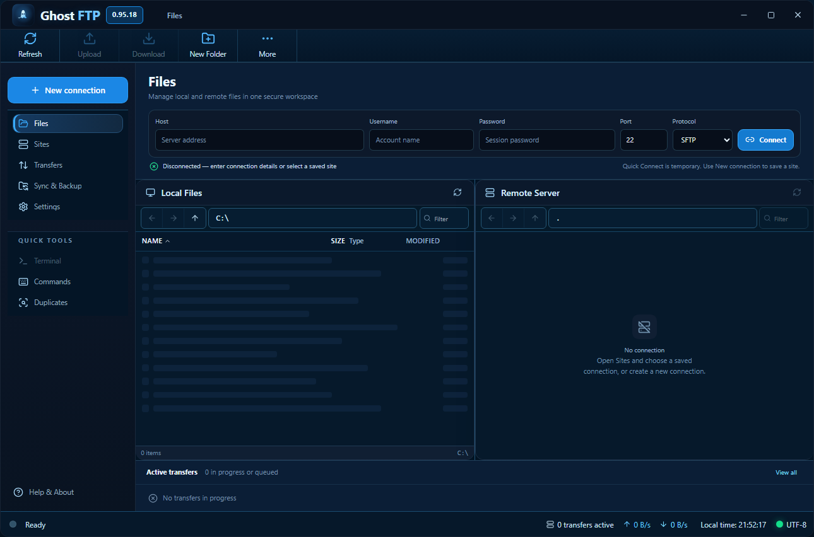</a>

<table>
<tr>
<td width="50%" align="center"><a href="docs/assets/screenshots/ghostftp-native-new-connection.png">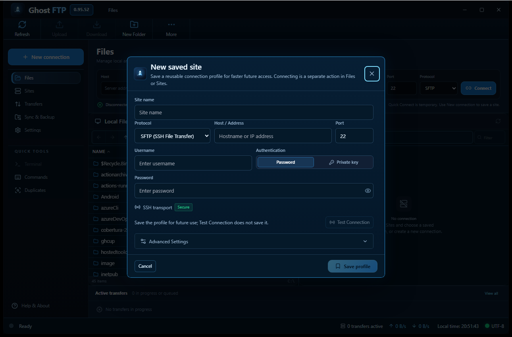</a><b>Connect with confidence</b> Make the connection yours.</td>
<td width="50%" align="center"><a href="docs/assets/screenshots/ghostftp-native-sites.png">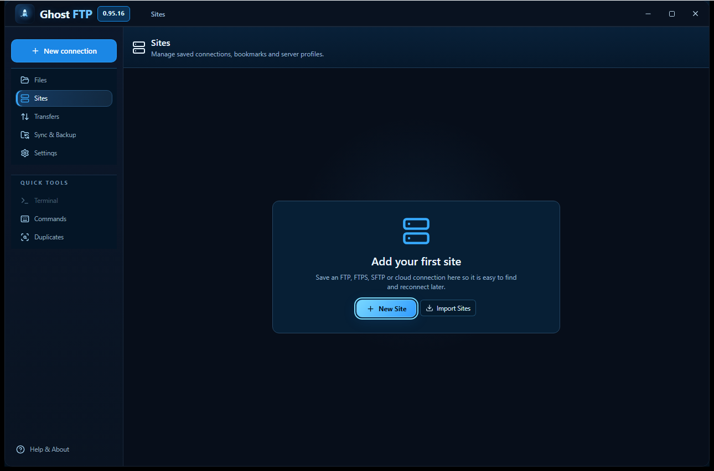</a><b>Stay organized</b> All your favorite destinations.</td>
</tr>
<tr>
<td align="center"><a href="docs/assets/screenshots/ghostftp-native-transfers.png">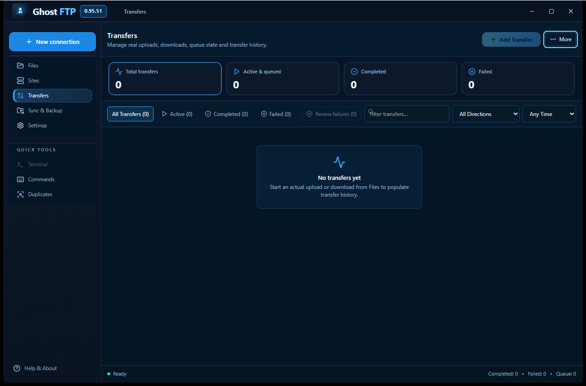</a><b>Keep transfers in view</b> Progress without the guesswork.</td>
<td align="center"><a href="docs/assets/screenshots/ghostftp-native-settings.png">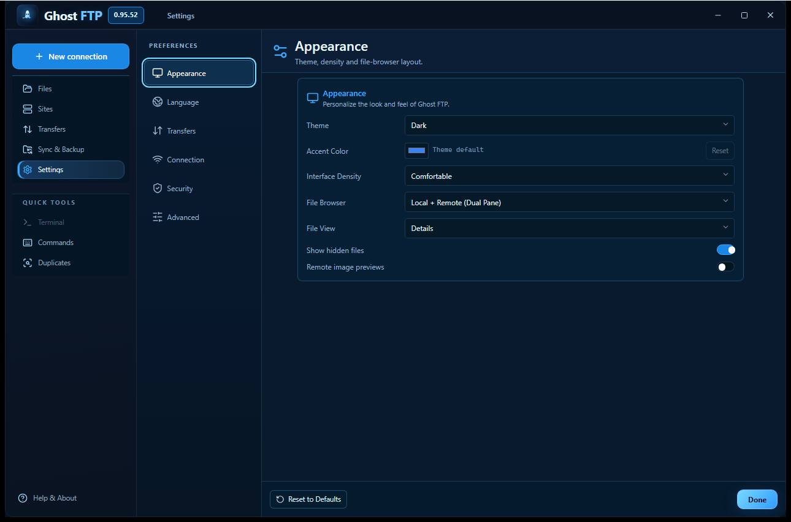</a><b>Make it yours</b> Controls where you need them.</td>
</tr>
</table>

<!-- BEGIN:real-linux-native-captures -->

### Linux — the real desktop experience

Browse files, organize sites, launch connections and manage transfers in Ghost FTP for Linux.

<table>
<tr>
<td width="50%" align="center"><a href="docs/assets/screenshots/native-linux/ghostftp-linux-files.png">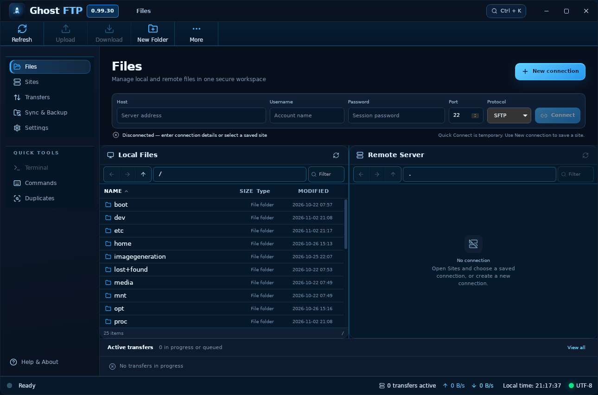</a><strong>Files</strong></td>
<td width="50%" align="center"><a href="docs/assets/screenshots/native-linux/ghostftp-linux-sites.png">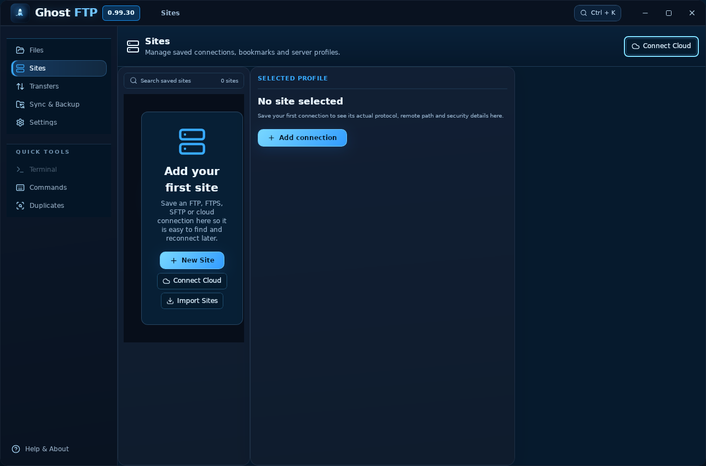</a><strong>Sites</strong></td>
</tr>
<tr>
<td align="center"><a href="docs/assets/screenshots/native-linux/ghostftp-linux-new-connection.png">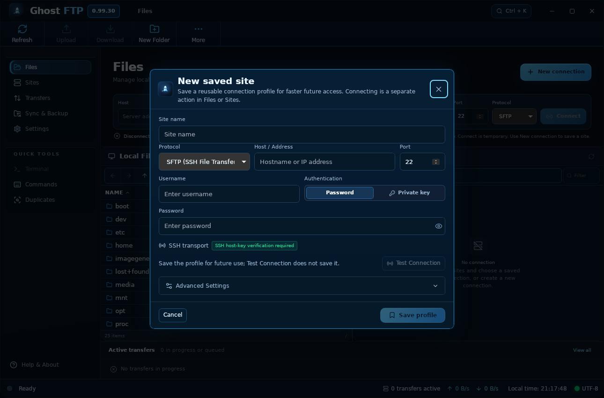</a><strong>New connection</strong></td>
<td align="center"><a href="docs/assets/screenshots/native-linux/ghostftp-linux-transfers.png">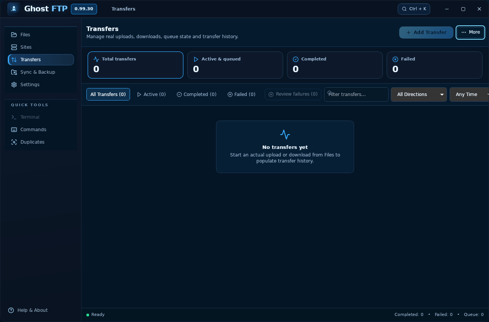</a><strong>Transfer Center</strong></td>
</tr>
<tr>
<td align="center"><a href="docs/assets/screenshots/native-linux/ghostftp-linux-sync.png">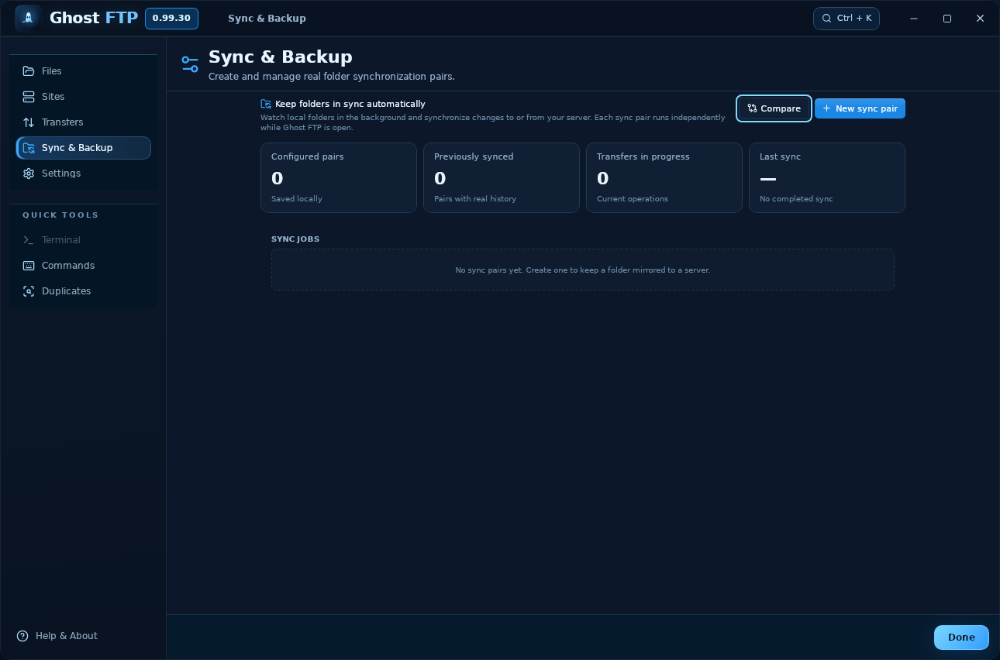</a><strong>Sync</strong></td>
<td align="center"><a href="docs/assets/screenshots/native-linux/ghostftp-linux-settings.png">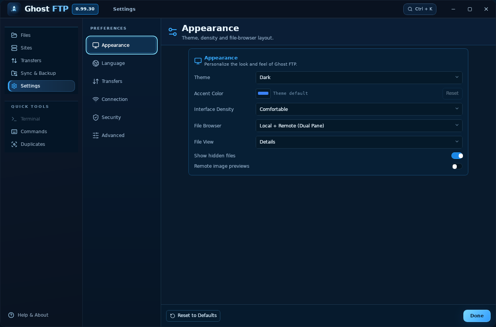</a><strong>Settings</strong></td>
</tr>
<tr>
<td align="center"><a href="docs/assets/screenshots/native-linux/ghostftp-linux-about.png">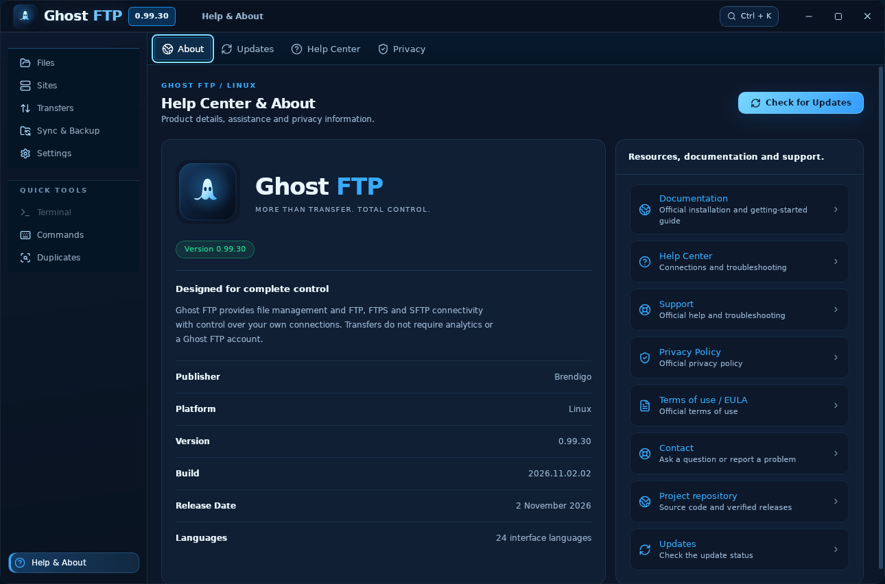</a><strong>Help & About</strong></td>
</tr>
</table>

Verified <strong>real Linux Tauri/WebKit UI</strong> from <a href="https://github.com/bren-wp/Ghost-FTP/actions/runs/41524829466">GitHub Actions native build 41524829466</a>, source SHA <code>01d816df5bdd3c76a8fa9c062371777cd345aa28</code>. These are historical native screenshots, not simulated screens or the latest version.

<!-- END:real-linux-native-captures -->

Original capture information: [Windows image provenance](docs/assets/screenshots/README-NATIVE-CAPTURE.json) · [Linux native capture workflow](https://github.com/bren-wp/Ghost-FTP/actions/runs/41524829466). Historical screenshots are not presented as captures of the current release.

## Choose your platform

| Platform | Download | Ideal for |
| --- | --- | --- |
| **🪟 Windows x64** | **Portable .exe** | Launch without a guided installation |
| **🪟 Windows x64** | **Setup .exe** | Standard desktop installation |
| **🪟 Windows x64** | **Setup .msi** | MSI-based or managed deployments |
| **🐧 Linux x86_64** | **AppImage** | Portable use on compatible Linux desktops |
| **🐧 Linux x86_64** | **.deb** | Debian and Ubuntu families |
| **🐧 Linux x86_64** | **.rpm** | Compatible Fedora, openSUSE and RHEL families |
| **🐧 Linux x86_64** | **Executable / .tar.gz** | Manual portable installation |

**[Get Ghost FTP for Windows or Linux](https://github.com/bren-wp/Ghost-FTP/releases)**

Each published version includes its own SHA-256 checksums. Pick the package for your operating system and verify the matching hash before installation. Platform compatibility and signing are documented in the [installation guide](docs/guides/INSTALLATION.md). Hashes show file integrity against the manifest; they do not establish publisher identity.

## From first connection to finished transfer

1. **Connect** to a server with FTP, explicit FTPS or SFTP, or select a supported cloud adapter.
2. **Explore** local and remote folders in one workspace.
3. **Transfer** files while tracking queue progress and reviewing outcomes.
4. **Return anytime** with saved profiles and preferences.

**For developers**, Ghost FTP keeps deployment and server-side file work close at hand. **For site owners**, it offers a clear view of what is on the computer and what is remote. **For administrators**, host identity checks and controlled file operations support more deliberate workflows.

## A clearer workspace in Ghost FTP 0.99.74 Preview

The **Sites** workspace makes better use of the desktop window, with a simpler first-connection experience and a responsive layout for saved connections. Browse, transfer and manage remote files from the same familiar workspace.

For the latest *published* packages, select [Releases](https://github.com/bren-wp/Ghost-FTP/releases). The previously published v0.99.73 Preview and full technical history are documented in the [changelog](CHANGELOG.md). Features vary by protocol and server.

## Your trust matters

FTP transmits data without encryption; use FTPS or SFTP for sensitive operations. SFTP host keys and FTPS certificates should be verified against a trusted source. Credentials are handled by OS-protected storage where available. Some cloud connections require OAuth consent or provider-specific credentials and may need separate setup.

[Features](docs/product/FEATURES.md) · [Security](SECURITY.md) · [Privacy](docs/legal/PRIVACY.md) · [Release notes](CHANGELOG.md) · [Support](https://ghostftp.com/hr/support)

Ghost FTP 0.99.74 is the current source version; consult GitHub Releases for published downloads. The images above are authentic, documented native captures from earlier builds, not certified v0.99.74 screenshots. A Stable release requires separate signing, installed-upgrade and native-platform verification.

---

**Ghost FTP — More Than Transfer. Total Control.**

Made by **BRENDIGO** · [brendigo.com](https://brendigo.com)

