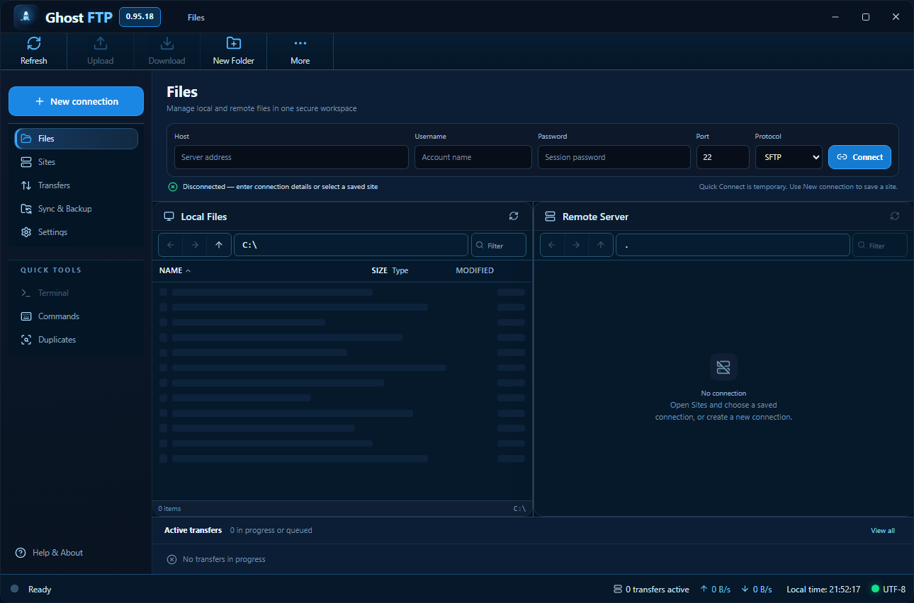
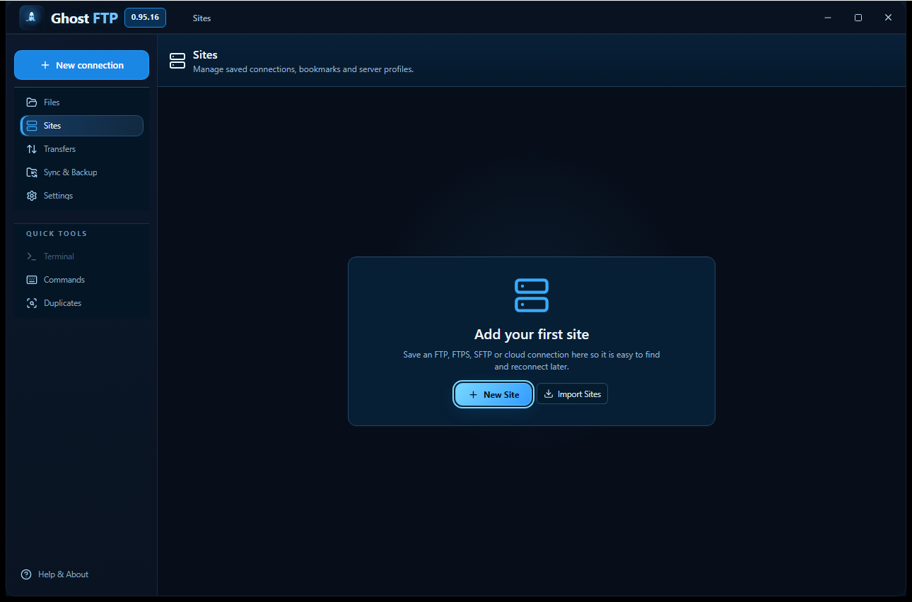
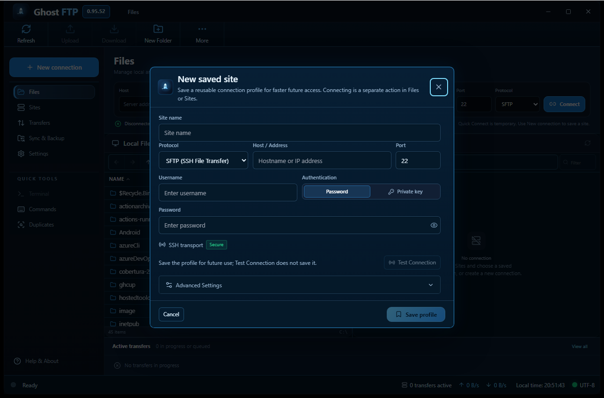
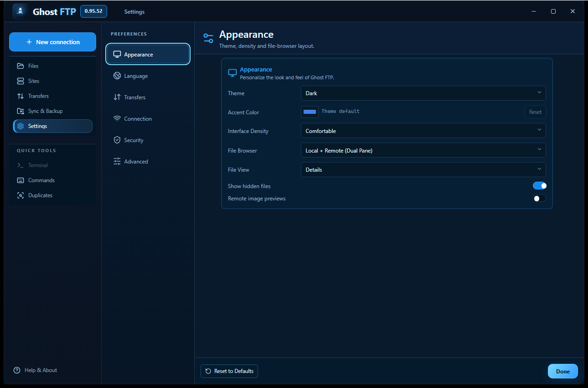
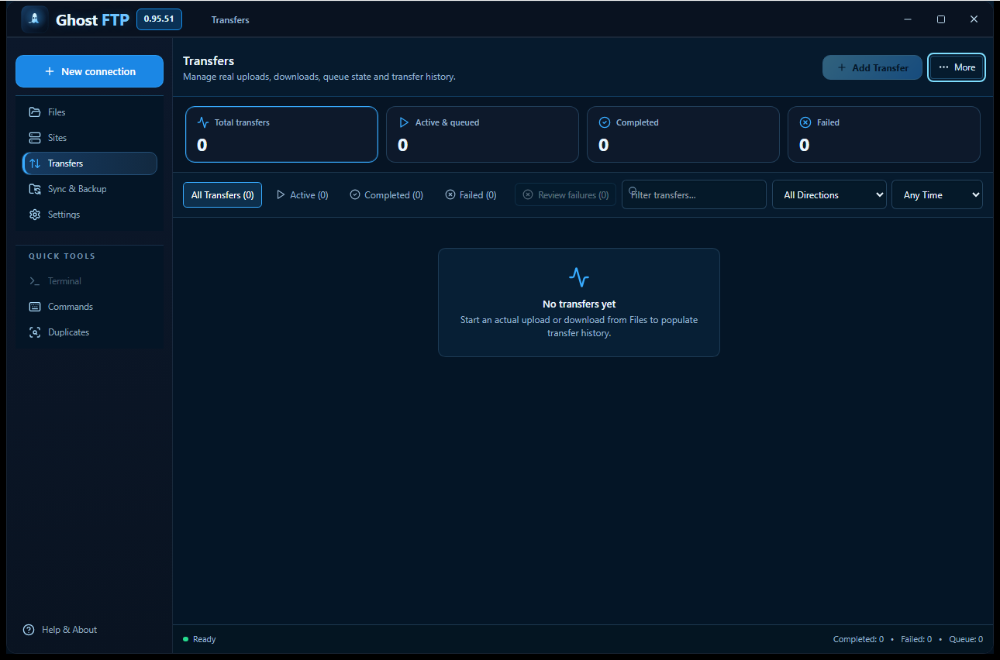
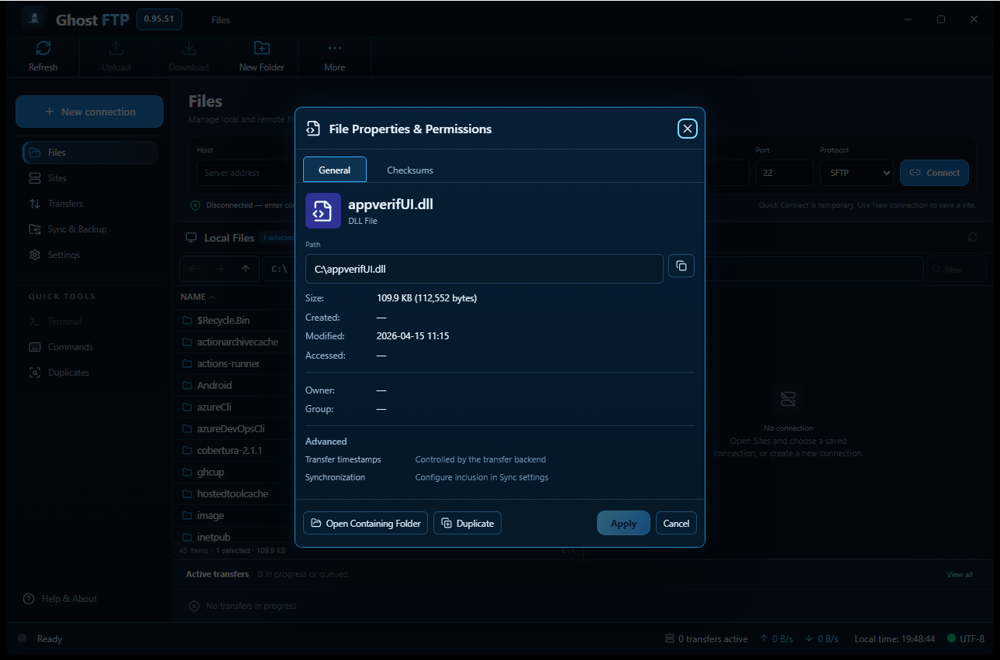
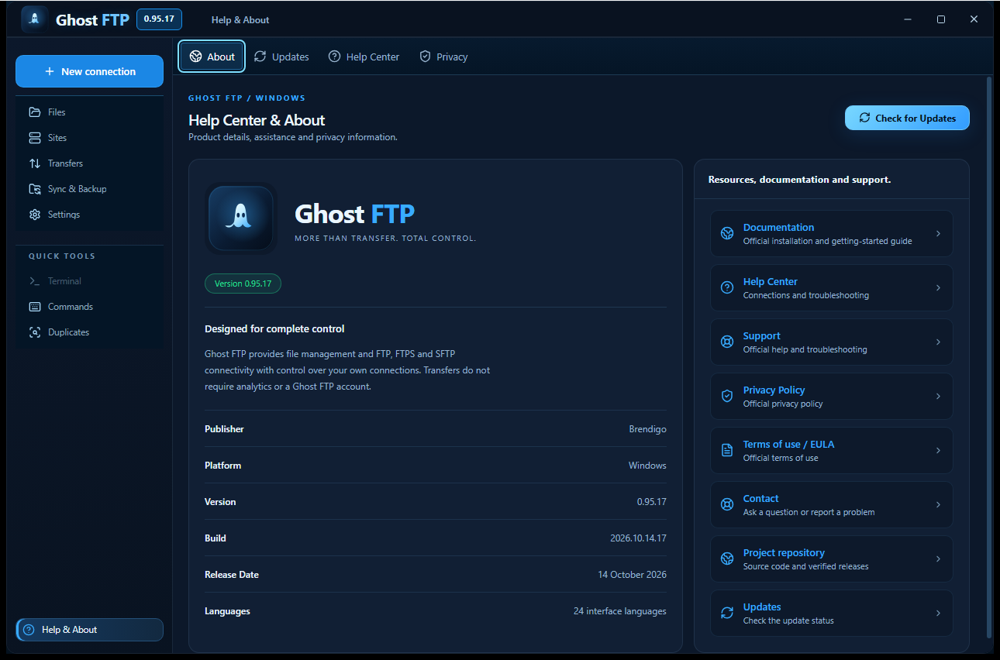

> **Ghost FTP 0.99.53 Preview development. Verified published predecessor: v0.99.52. Linux Secret Service subprocess pipe/timeouts hardened; real keyring, cloud and 59-screen acceptance remain pending.**

> **Current development (10 November 2026): Ghost FTP 0.99.42 Preview.** Preserve splash-free Windows/Linux startup and repair the authenticated v0.99.41 release filename/Preview metadata drift without replacing historical bytes. Previous published edition: v0.99.41. Production signing, live providers and 1:1 reference acceptance remain separate.

> **Current development (10 November 2026): Ghost FTP 0.99.41 Preview.** Windows/Linux open directly in Files without an artificial splash; native QA validates seven real workspaces. Scheduled transfer checks also respond to window wake and connectivity restoration. Previous published edition: v0.99.40 (release verification required). Signing, live providers and 1:1 reference acceptance remain separate.

> **Current development (10 November 2026): Ghost FTP 0.99.40 Preview.** Repair late GitHub prerelease metadata drift with verified checksums and post-publication regression gates. Public predecessor: v0.99.39. Live-provider, production signing and full pixel-parity acceptance remain separate.

> **Current development (10 November 2026): Ghost FTP 0.99.39 Preview.** One canonical release asset inventory, exact SHA-256 verification and reliable Preview post-release checks. Public predecessor: v0.99.38. Production signing and 1:1 visual acceptance remain separate.

> **Current development (10 November 2026): Ghost FTP 0.99.38 Preview.** Windows/Linux transfer-history reliability and release safety improvements. Public predecessor: v0.99.37. Production signing and 1:1 visual acceptance remain separate.

> **Current development (9 November 2026): Ghost FTP 0.99.37 Preview.** Windows/Linux DST-safe scheduled transfers, resumable SHA-256-verified release uploads and stricter release gates. Previous published release: v0.99.36. Signed-production status and 1:1 visual parity are not claimed.

> **Current development (11 November 2026): Ghost FTP 0.99.47 Preview.** Windows/Linux desktop-only release line, with FTP/FTPS/SFTP and cloud transfer security under review. Public v0.99.35 stays immutable. No unverified claims of perfect UI parity or universal provider interoperability.

> **Current development (6 November 2026): Ghost FTP 0.99.33 Preview.** Published v0.99.32 remains immutable. Windows/Linux unsigned installers can be manually installed; signed in-app updates still require verified signatures. New update-fallback, safe download link and data-preservation safeguards are under exact-head test; physical desktop production acceptance is not yet certified.

> **Current development (6 November 2026): Ghost FTP 0.99.32 Preview.** The preceding published release is v0.99.31. Windows/Linux native file workspace, real connection health, bounded grant imports and resource usage are the focus. Security fixes are source/test changes, not independent penetration-test or full installed-device certification. Historical editions and published assets remain immutable.


> **Authoritative current state (2 November 2026):** Ghost FTP **0.99.30 development Preview**; v0.99.29 is the latest publicly published version. Standalone Ghost FTP Server, Demo and CLI are retired from current source and new release packages. Client protocol support remains platform-dependent; security and installed-device validation are not yet certified. Older entries below are historical.

> **Authoritative current state (26 October 2026):** Ghost FTP **0.99.15 Preview**; latest published version **v0.99.14**. Older notes below retain their historical version context.

<p align="center">

> Current development source: **0.99.30**; latest publicly published release: **0.99.29**. The desktop application remains on the shared Windows/Linux codebase.
  
</p>

<h1 align="center">Ghost FTP Desktop</h1>
<p align="center"><strong>More Than Transfer. Total Control.</strong></p>

<p align="center">
  <a href="../README.md">Product README</a> ·
  <a href="https://ghostftp.com/hr/how-to-download">Documentation</a> ·
  <a href="https://github.com/bren-wp/Ghost-FTP/releases">Releases</a>
</p>

---

## Production application

This directory contains the authoritative **Ghost FTP desktop application**.

The release line opens as a real desktop window. It does not launch the production GUI through a localhost browser wrapper, and it must not expose a visible `127.0.0.1` address/origin bar.

Current development line: **0.99.53**. Previous canonical release: **0.99.52**.

## Platform deliverables

| Platform | Deliverables |
| --- | --- |
| Windows 10/11 x64 | portable `ghostftp.exe`, NSIS Setup EXE, MSI |
| Linux x86-64 | native executable, AppImage, DEB, RPM |

MSI is part of the canonical Windows package set and is covered by install/uninstall smoke validation in the native build workflow.

## Core capabilities

- FTP, FTPS and SFTP workflows
- dual-pane local/remote file management
- Quick Connect and saved Site Manager profiles
- transfer queues with progress, retry, pause/resume and cancellation
- file operations, checksums and permissions where supported
- SSH key and host-key verification paths
- OS-protected credentials where supported
- remote editing, synchronization, comparison and terminal tooling
- signed desktop updater path
- 14 advertised interface languages
- no required analytics or telemetry
- terminal suggestion history remains process-memory only and credential-looking commands are excluded

## Visual contract

The repository keeps **actual native screenshots** under **[`../docs/assets/screenshots/`](../docs/assets/screenshots/)**. The Windows QA workflow refreshes them from the real executable; they are documentation evidence only and are never used as runtime screenshot backgrounds or click maps.

<p align="center">
  <a href="../docs/assets/screenshots/ghostftp-native-files.png"></a>
</p>

<p align="center">
  <a href="../docs/assets/screenshots/ghostftp-native-sites.png"></a>
  <a href="../docs/assets/screenshots/ghostftp-native-new-connection.png"></a>
</p>

<p align="center">
  <a href="../docs/assets/screenshots/ghostftp-native-settings.png"></a>
  <a href="../docs/assets/screenshots/ghostftp-native-transfers.png"></a>
</p>

<p align="center">
  <a href="../docs/assets/screenshots/ghostftp-native-file-properties.png"></a>
  <a href="../docs/assets/screenshots/ghostftp-native-about.png"></a>
</p>

<p align="center"><sub>All seven images are direct 1290×852 captures from the release-proven Windows QA build. Click any image for the original full-resolution PNG.</sub></p>

The canonical desktop reference is **1290×852** and the production window minimum is **480×600**. Ghost FTP keeps one persistent native application window: Files, Sites, Transfers, Sync & Backup, Settings and Help & About switch inside the main workspace; New Connection and File Properties remain transient overlays inside that same window.

Native Windows QA captures all seven critical surfaces at three viewport classes:

| QA class | Viewport |
| --- | ---: |
| Canonical | 1290×852 |
| Compact | up to 720×640 |
| Near minimum | 500×620 |

The QA workflow rejects blank/structureless frames, duplicate captures, unexpected window titles, invalid launch geometry and missing evidence. Smaller layouts use contained scrolling and icon compaction rather than removing primary actions.


The canonical screenshots shown in the repository are generated from that native QA run and tracked as:

- `ghostftp-native-files.png`
- `ghostftp-native-sites.png`
- `ghostftp-native-new-connection.png`
- `ghostftp-native-settings.png`
- `ghostftp-native-transfers.png`
- `ghostftp-native-file-properties.png`
- `ghostftp-native-about.png`

They are direct captures of the running native application, not design mockups.

### Ghost FTP palette

```text
Electric Blue  #38ABFF
Deep Navy      #0B1E36
Slate Blue     #132D52
Ice White      #EAF6FF
Success        #26DC8F
Danger         #FF5A65
```

## Source layout

```text
ghostftp-desktop/
├── branding/                 Ghost FTP SVG logo and symbol
├── packages/file-ui/         shared file-browser UI package
├── scripts/                  icon/build/verification utilities
├── src/                      React application
│   ├── components/           application surfaces and controls
│   ├── lib/                  IPC, i18n, commands and helpers
│   ├── stores/               application state
│   └── styles.css            visual and responsive rules
├── src-tauri/                internal native Rust/framework build area
│   ├── ghostftp-agent-proto/
│   └── ghostftp-agentd/
└── web/                      static companion/loading surface
```

Native identifier: `com.ghostftp.desktop`  
Deep-link scheme: `ghostftp://`  
Local database namespace: `ghostftp.db`

The `src-tauri/` and `tauri.conf.json` names remain because the framework/toolchain consumes them directly. They are implementation details rather than public Ghost FTP branding.

## Development

Requirements:

- Node.js 22+
- npm
- stable Rust + Cargo
- desktop framework platform prerequisites
- Windows: WebView2 + Visual Studio native build tools
- Linux: WebKitGTK 4.1 and packaging dependencies

Install exact dependencies and validate the frontend:

```bash
npm ci
npm run check
npm run build
```

Run development mode:

```bash
npm run tauri dev
```

Build the current platform:

```bash
npm run tauri build
```

Windows packages:

```powershell
npm run build:windows
```

Linux packages:

```bash
npm run build:linux
```

GitHub Actions is the authoritative production build environment.

## Quality gates

The repository quality workflow verifies:

- TypeScript typecheck and production frontend build
- Rust formatting, workspace compilation and tests
- Clippy with warnings denied
- Go tests/vet for compatibility tooling
- JavaScript syntax for companion surfaces
- legacy/demo-branding rejection

The native build workflow separately produces the Windows and Linux release artifacts. GitHub release publication is gated on successful build output and quality evidence.

See:

- [Build status](../docs/build/STATUS.md)
- [Code audit](../docs/audits/CODE.md)
- [Pixel parity](../docs/qa/PIXEL_PARITY.md)
- [Responsive QA](../docs/qa/RESPONSIVE.md)
- [Titlebar QA](../docs/qa/TITLEBAR.md)
- [Transfer QA](../docs/qa/TRANSFERS.md)

## Security and privacy

Credentials and connection details remain under user control. Profiles use OS-protected credential facilities where supported, SSH host-key verification is explicit, and update packages follow the signed updater path. Sensitive secrets must never be written to logs.

Read [SECURITY.md](../SECURITY.md), [Privacy](../docs/legal/PRIVACY.md) and [Update Policy](../docs/guides/UPDATES.md).

---

<p align="center">
  <br>
  <strong>Ghost FTP — Files Move Forward.</strong>
</p>
